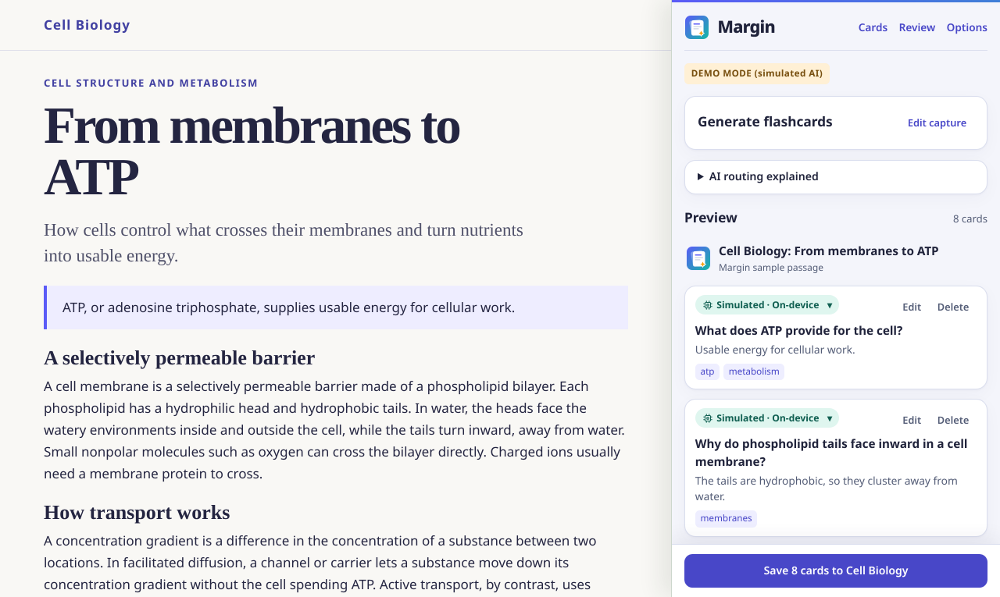
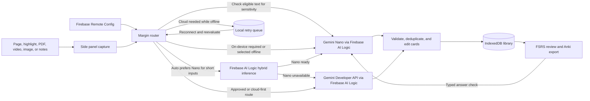

# Margin

**Learn what you read. Sensitive text stays on-device. Cloud when it counts.**

Margin is a Chrome extension that turns web pages, highlights, PDFs, YouTube videos, images, and pasted notes into flashcards. Edit the cards in the side panel, revisit the source passage, and use spaced repetition to remember what you read. Every generated card carries a routing badge that explains where the work ran and why.



## What you can do

- Generate basic or cloze cards, then search, edit, move, or delete saved cards in **Cards**.
- Follow source links back to highlighted selections or excerpts from captured pages where text fragments are supported.
- From a source tab, use **Make flashcards from selection**, **Make flashcards from this page**, or **Make flashcards from image**. Choose **YouTube** in the side panel to use a video's captions. The resulting cards link back to the video page.
- Check typed answers with Gemini Nano and use the suggested rating or rate yourself. FSRS schedules the next review.
- See on-device routing stats, turn on Privacy mode, and manage offline captures.
- Export decks to Anki as TSV or `.apkg`.

## How Margin maps to the judging criteria

| Criterion | What Margin delivers |
| --- | --- |
| Technological Implementation | Firebase AI Logic uses Gemini Nano for eligible on-device tasks and Gemini in the cloud for longer or unsupported inputs. The router checks sensitivity and queues cloud work when offline. [Router](src/ai/router.ts), [Firebase provider](src/ai/firebaseProvider.ts), [retry queue](src/ai/queue.ts) |
| Design | Readers can capture, edit, and save cards in the side panel. Expandable badges explain where inference ran and why. The review page shows typed answers beside the expected answer. [Side panel](src/ui/sidepanel.ts), [route badges](src/ui/shared.ts), [review](src/ui/review.ts) |
| Potential Impact | Readers can build a study library from pages, PDFs, or videos, use Privacy mode to require local inference, and take decks to Anki. [Capture](src/sources/capture.ts), [local library](src/storage/db.ts), [Anki export](src/export/apkg.ts) |
| Quality of the Idea | Margin connects reading to long-term recall. Cards preserve links to their source, on-device feedback checks recall, and FSRS schedules the next review. [Source anchors](src/sources/selection.ts), [answer grading](src/ai/grade.ts), [FSRS](src/srs/fsrs.ts) |

## Built with AI coding tools

Claude Opus 5.5 via Kiro CLI handled architecture and reviews. GPT-6.2 Sol via Codex CLI handled implementation. Live AI inference runs through Firebase AI Logic.

## Hybrid architecture

The MV3 service worker opens the side panel and hands off context-menu captures. Inference runs in the side panel or review page. Firebase Remote Config supplies routing settings, with bundled defaults for offline use and demo mode.



### Routing rules

| Situation | Outcome |
| --- | --- |
| Privacy mode or Only on-device | Require Gemini Nano. Split long text into local chunks. Show an error for unavailable Nano or unsupported media. |
| Text flagged as sensitive | Require on-device inference. If only the pattern check fired and Nano is unavailable, cloud inference requires your approval for that capture. Privacy mode and Only on-device keep the capture local. |
| Short, nonsensitive text or PNG/JPEG in Auto | Prefer Gemini Nano through Firebase AI Logic. Firebase can fall back to cloud when Nano is unavailable. The default input budget is 6,000 estimated tokens, with 1,500 reserved for output. CJK text is estimated at roughly one token per character. |
| Long text | Prefer the long-document cloud model for cloud-eligible text when online in Auto. Split into local chunks when Nano is ready and the router selects on-device inference. Chunks overlap by about 10% at sentence boundaries where possible. Margin deduplicates cards across chunks. |
| Scanned PDF or video without accessible captions | Use the long-document cloud model. Margin extracts readable PDF text or captions locally when available. |
| Nano unavailable for a cloud-eligible capture | Use the cloud when online. Downloadable and downloading states point to **Enable on-device AI**. |
| Cloud needed while offline | Queue the capture locally. Cloud approval given offline stays with that capture. Keep the side panel open for automatic retries when you're online. It reroutes on reconnect and retries failures with 30-second and 60-second delays. After three failed attempts, the entry shows **Failed** with a manual retry in Options. |
| Typed answer during review | Check with Nano only. Manual reveal and self-rating are always available. |

Margin can send up to 14 MB of raw media per capture for images, screenshots, and PDFs without extractable text.

When the sensitivity check is enabled, Margin checks text for patterns locally and uses on-device classification on eligible cloud routes when Nano is available. A malformed classification is treated as sensitive. In the side panel, expand **AI routing explained** to see the active input budget, models, sensitivity setting, and cards per chunk.

## Install

**From a ZIP**

1. Extract `margin-extension.zip` to a folder. The folder should contain `manifest.json`.
2. Open `chrome://extensions`, turn on **Developer mode**, and choose **Load unpacked**.
3. Select the extracted folder. Open the Margin toolbar popup on a source tab and choose **Open side panel**.

**From source**

Use Node.js 24 LTS (24.15 or newer).

```sh
npm ci
npm run build
```

Load the resulting `dist/` folder using the same steps. To update a loaded extension after rebuilding, click **Reload** on its card in `chrome://extensions`, then reopen Margin.

## Connect a real Firebase project

Margin uses **Firebase AI Logic** for hybrid inference, **App Check** to attest requests, and **Remote Config** for routing settings. The optional backup uses **Firebase Authentication** and **Cloud Firestore**.

1. Create a Firebase project and add a **Web app** in **Project settings**. In **AI Services → AI Logic**, select **Get started**, choose **Gemini Developer API**, and finish enabling the required services. [Firebase AI Logic setup](https://firebase.google.com/docs/ai-logic/get-started?platform=web)
2. Copy `firebase.config.example.json` to `firebase.config.local.json`. Paste the values from the Firebase web app configuration into that JSON file. Run `npm run build` and load or reload `dist/`. The local file is ignored by Git. [Firebase web configuration](https://firebase.google.com/docs/web/learn-more#config-object)
3. Open the side panel or Options and inspect that extension page with Chrome DevTools. Find the **Firebase App Check debug token** logged on initialization. In Firebase Console, open **App Check → Apps**, find the web app, choose **Manage debug tokens**, and register the value. Enter the registered token in **Margin Options → App Check debug token** to use it for both inference and backup. Changing the token reloads the extension. Reopen Margin after saving. Keep debug tokens private. Live mode currently works only with a registered App Check debug token; the production App Check provider needs a token issuer that this build does not include. [App Check debug provider](https://firebase.google.com/docs/app-check/web/debug-provider)
4. Use desktop Chrome 139 or newer on a device that supports the Prompt API. Enable `chrome://flags/#prompt-api-for-gemini-nano-multimodal-input`, restart Chrome, and click **Enable on-device AI** in the side panel when offered. Wait for **On-device ready**. [Firebase hybrid setup and Chrome requirements](https://firebase.google.com/docs/ai-logic/hybrid/web/get-started)
5. In Margin Options, turn off **Demo mode**, select **Auto router**, and run the live test under **Diagnostics**. To verify the cloud route explicitly, select **Only cloud** and generate from nonsensitive notes. Return to Auto afterward.
6. Optionally publish Firebase Remote Config values for `maxOnDeviceTokens`, `cloudModel`, `longDocModel`, `sensitivityCheck`, and `maxCardsPerChunk`. Set the cloud model names to models available to your Firebase project.

## Demo mode

Without Firebase configuration, Margin uses a deterministic simulation for generation, routing, and answer feedback. A **DEMO MODE (simulated AI)** banner identifies every extension page in that mode. Options can enable the simulation on a configured build, and `MOCK=1 npm run build` forces it for the built extension. Demo generation and grading work without Firebase credentials.

For a quick look, open the side panel, select **Try a sample** and **Generate**, then save the cards. Open **Review**, choose **Reveal answer**, and rate the card. [Judge testing instructions](submission/testing-instructions.md)

## Diagnostics

Open **Options → Diagnostics** to check the Chrome version, Prompt API, current `LanguageModel.availability()` result, Firebase configuration, App Check limited-use token, Remote Config values, and Demo or Live mode. If Firebase rejects the debug token, verify its registration in Firebase Console and reopen Options.

**Run live hybrid test** sends one built-in prompt through Firebase AI Logic with `PREFER_ON_DEVICE`. The result shows the returned `inferenceSource` (`on_device` or `in_cloud`) and inference latency. The prompt contains no library or captured content. Live mode and a configured Firebase project are required. [Firebase hybrid inference options](https://firebase.google.com/docs/ai-logic/hybrid/web/configuration-options)

## Firestore backup

1. In the same Firebase project, enable the **Anonymous** sign-in provider under **Authentication → Sign-in method**. [Anonymous Authentication setup](https://firebase.google.com/docs/auth/web/anonymous-auth)
2. Create a Cloud Firestore database and publish [firestore.rules](firestore.rules) in its **Rules** tab. The rules limit access under each user path to that user's authenticated UID. [Firestore Security Rules](https://firebase.google.com/docs/firestore/security/rules-conditions)
3. In **Options → Firestore backup**, turn on **Back up decks to Firestore**. Margin signs in anonymously and backs up the library when enabled and after local card or deck changes. Use **Back up now** to retry. Automatic backups upload only changed decks and cards, and **Back up now** uploads everything. Backup and restore are paused in Demo mode and Privacy mode.

The background service worker logs its App Check debug token on its first backup attempt. Find its console from the **service worker** link on Margin's card in `chrome://extensions`.

Firestore stores decks under `users/{uid}/decks/{deckId}` and cards under `users/{uid}/cards/{cardId}`. Deck documents contain the name and creation time. Card documents contain the front and back, which can quote the source, plus the deck ID, card type, creation time, optional tags, and optional FSRS schedule. The captured passage, source URL, routing history, and review logs stay out of the backup.

**Restore from backup** adds missing decks and cards while preserving local copies with matching IDs. Backed-up decks merge into local decks whose names match after ignoring case and extra whitespace. Backed-up decks or cards that fail validation are skipped, and the restore reports how many were skipped. Local deletions remain in existing backups and can reappear on restore. The anonymous account is tied to this Chrome profile and extension ID. Clearing its extension data or switching profiles can leave the backup inaccessible.

## Scripts

Use Node.js 24 LTS (24.15 or newer) and install Playwright Chromium with `npx playwright install chromium`. On Linux CI, `npx playwright install --with-deps chromium` also installs browser system dependencies.

| Command | Purpose |
| --- | --- |
| `npm run build` | Bundle the MV3 extension in `dist/` and verify that Firebase AI Logic calls are present. |
| `npm run typecheck` | Check TypeScript. |
| `npm test` | Run unit tests. |
| `npm run test:e2e` | Build and run the extension in Playwright Chromium in demo mode. |
| `npm run screenshots` | Build and render screenshots and the 1500 × 1000 cover in `submission/screenshots` with a seeded study library. |
| `npm run package` | Build and create `margin-extension.zip` with the manifest at the archive root. |

## Project structure

| Path | Purpose |
| --- | --- |
| `src/ai/`, `src/firebase/` | Routing, providers, prompts, retry queue, and Firebase integration |
| `src/sources/` | Capture, PDF text extraction, captions, and source anchors |
| `src/cards/`, `src/storage/`, `src/srs/` | Card validation, local library, and review scheduling |
| `src/ui/`, `src/background.ts` | Extension pages and MV3 service worker |
| `src/export/` | TSV and Anki package export |
| `test/`, `scripts/`, `submission/` | Tests, tooling, and submission materials |

## Privacy

Cards, route history, queued source material, and review history live in this Chrome profile. On-device generation and typed-answer grading keep their input on the device. Cloud routes send source content or media to Firebase AI Logic and the Gemini API. Privacy mode is off by default. In Auto, long nonsensitive text can go to the cloud. Turning on Privacy mode requires on-device inference and blocks Firestore backup and restore. Firestore backup is also off by default. When Firebase is configured and Demo mode is off, Margin still fetches routing settings from Firebase Remote Config. Margin uses temporary Chrome tab access for captures and requests access to a particular site when a page or PDF needs additional permission. You can manage granted site access in Chrome’s extension settings.

## License

Margin is available under the [Apache License, Version 2.0](LICENSE).
